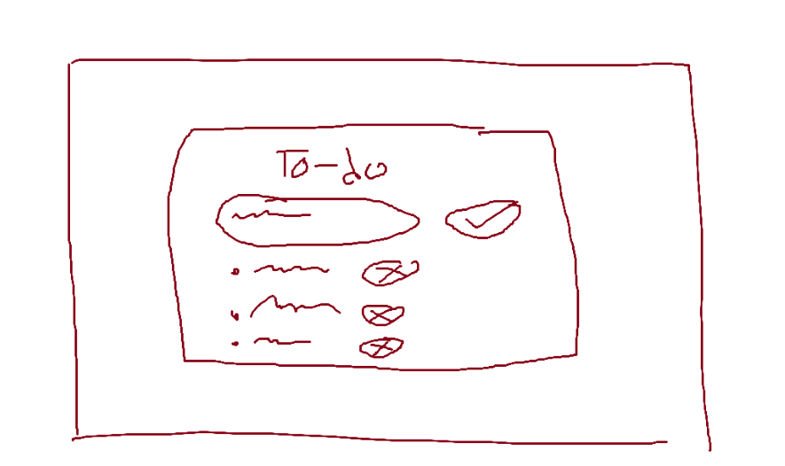
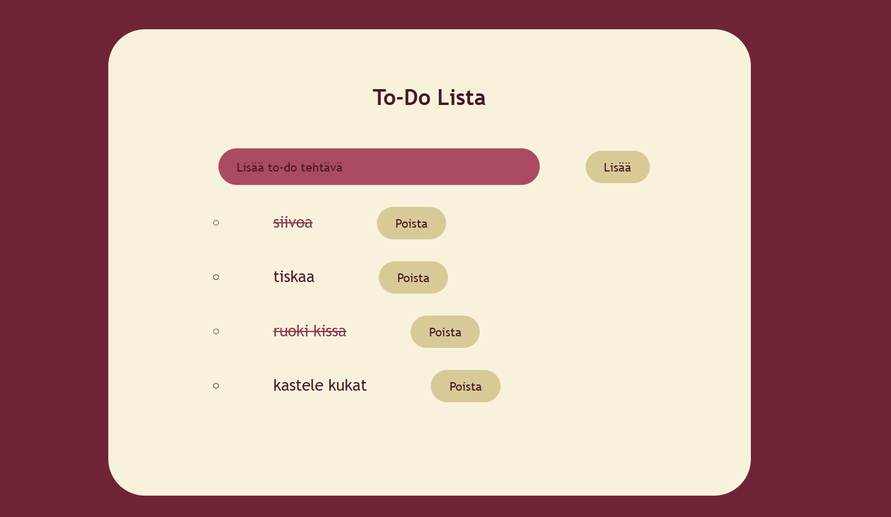

# to-do lista

**Tekijä:** Jessica Rusila

## Projektisuunnitelma

### Projektin idea

Sovellus on to-do lista minne voi lisätä ja poistaa tehtäviä, sekä merkata tehtävät tehdyksi.

### Suunnitellut toiminnot

Listaa vähintään kolme sovellukseesi suunniteltua toimintoa:

- Voi lisätä tehtäviä
- Voi poistaa tehtäviä
- Voi merkata tehtävät tehdyksi

### Rautalankamalli / luonnos

## Verkkolinkit

- **Julkaistu sovellus:** [Lisää tähän GitHub Pages -osoite](https://jessrus.github.io/Projekti1_DOM_Skriptaus/)
- **GitHub-repositorio:** [Lisää tähän repositorion osoite](https://github.com/JessRus/Projekti1_DOM_Skriptaus.git)
- **Projektin videoesittely:** [Lisää tähän videon osoite](https://youtu.be/ENJq12sRAtY)

## Tietoja sovelluksesta

**[To-do lista]** on verkkosovellus, jossa voi lisätä, poistaa ja merkata tehtäviä tehdyiksi.

## Teknologiat

Kuvaile, mitä teknologioita käytit ja mikä niiden rooli oli projektissasi.

- HTML – sivun rakenne
- CSS – ulkoasu ja asettelu
- JavaScript – toiminnallisuus, DOM-skriptaus ja lomakkeiden validointi

## Sovelluksen käyttö

Kirjoita lyhyet käyttöohjeet sovellukselle.

1. Avaa julkaistu sovellus yllä olevasta linkistä.
2. Lisää kenttään to-do tehtäviä.
3. Lisää, poista tai merkitse kohteita tehdyiksi.

## Sovelluksen käynnistäminen paikallisesti

1. Kloonaa tai lataa tämä repositorio omalle koneellesi.
2. Avaa projektikansio.
3. Avaa `index.html` selaimessa.

## Kuvakaappaukset

## Tunnetut virheet / puutteet

 Ei tunnettuja virheitä.

## Oma arvio ja oppimisen reflektointi

Pohdi työtäsi ja oppimisprosessiasi.

- Missä onnistuin?
**Sain tehtyä ihan toimivan to-do listan.**
- Mikä oli haastavaa?
**Javascripti on minusta vaikeaa.**
- Mitä parantaisin, jos aikaa olisi enemmän? 
**Lisäisin enemmän asioita kuten esimerkiksi tallenus selaimeen.**
- Mitä opin HTML:stä, CSS:stä, JavaScriptistä ja DOM-skriptauksesta?
**Opin paremiin soveltamaan mitä olen oppinut tällä kursilla.**
- Mikä jäi epäselväksi tai mistä haluaisin oppia lisää?
**Javascript on yhä vaikeaa, joten haluaisin parantaa taitojani siinä.**
- Oma arvio projektista: **6/10 pistettä**

## Lähteet ja kiitokset

- [Käytin tätä videota apunani](https://youtu.be/G0jO8kUrg-I?si=WDrjOv6gosFG2hTV)
- Käytetty tekoälytyökalu: ChatGPT
  - Miten työkalua käytettiin: Käytin tekoälyä virheiden korjaamiseen.
